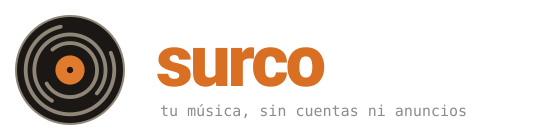

<div align="center">


### Skill de Claude Code para portadas de README: y el registro de cada una, para que ninguna se repita.

<br/>

[](#galeria)
[](#estilos-de-titulo)
[](#como-funciona)

[](https://docs.claude.com/en/docs/claude-code/skills)
[](#como-funciona)
[](assets)

[**Galeria**](#galeria) • [**Catalogo**](#catalogo) • [**Estilos de titulo**](#estilos-de-titulo) • [**Como funciona**](#como-funciona) • [**Instalar**](#instalar)

</div>

---

## Galeria

Los titulos animados de cada README, tal como estan en su repo. Click para ver el README completo.

<table>
<tr>
<td width="50%" align="center"><a href="https://github.com/Mickaell22/mcp-context-server"></a><br/><b>mcp-context-server</b> · shimmer</td>
<td width="50%" align="center"><a href="https://github.com/Mickaell22/ApplyJob"></a><br/><b>ApplyJob</b> · split-flap</td>
</tr>
<tr>
<td align="center"><a href="https://github.com/Mickaell22/mcp-context-dashboard"></a><br/><b>mcp-context-dashboard</b> · typewriter</td>
<td align="center"><a href="https://github.com/Mickaell22/claude-sudo-askpass"></a><br/><b>claude-sudo-askpass</b> · glitch</td>
</tr>
<tr>
<td align="center"><a href="https://github.com/Mickaell22/surco"></a><br/><b>surco</b> · spin</td>
<td align="center"><a href="https://github.com/Mickaell22/restoventas-app"></a><br/><b>restoventas-app</b> · glow</td>
</tr>
<tr>
<td align="center"><a href="https://github.com/Mickaell22/restoventas-backend"></a><br/><b>restoventas-backend</b> · underline</td>
<td align="center"><a href="https://github.com/Mickaell22/restopanel"></a><br/><b>restopanel</b> · underline</td>
</tr>
<tr>
<td align="center"><a href="https://github.com/Mickaell22/mickaell-portafolio"></a><br/><b>mickaell-portafolio</b> · cascade</td>
<td align="center"><a href="https://github.com/Mickaell22/Mickaell22"></a><br/><b>Perfil Mickaell22</b> · marquee</td>
</tr>
<tr>
<td align="center"><a href="https://github.com/Mickaell22/mickhub"></a><br/><b>MickHub</b> · graph</td>
<td></td>
</tr>
</table>

---

## Catalogo

La fuente de verdad que la skill lee antes de elegir: **un estilo de titulo no se repite entre repos** salvo en la misma familia de producto.

| Repo | Titulo | Acento | Hero | En el cuerpo |
|---|---|---|---|---|
| [mcp-context-server](https://github.com/Mickaell22/mcp-context-server) | shimmer | `#6C5CE7` `#39D3E8` `#3FDD78` | diagrama animado del flujo | barras con una medicion real, tarjetas de tools |
| [ApplyJob](https://github.com/Mickaell22/ApplyJob) | split-flap | `#FFC940` `#3FDD78` | diagrama del pipeline: zona "sin API" y zona "usa API" | tarjetas de fuentes por protocolo, pasos en tabla |
| [mcp-context-dashboard](https://github.com/Mickaell22/mcp-context-dashboard) | typewriter | `#6366F1` `#A5B4FC` `#10B981` | captura del dashboard | capturas de queries y proyectos |
| [claude-sudo-askpass](https://github.com/Mickaell22/claude-sudo-askpass) | glitch | `#F5C2E7` `#F38BA8` (Catppuccin) | captura del prompt real | capturas de los temas |
| [surco](https://github.com/Mickaell22/surco) | spin | `#E07B2E` `#D96F22` | capturas de la app | capturas por pantalla |
| [restoventas-app](https://github.com/Mickaell22/restoventas-app) | glow | `#EA580C` `#F97316` | captura de la app | |
| [restoventas-backend](https://github.com/Mickaell22/restoventas-backend) | underline | `#EA580C` `#16A34A` | imagen del producto | |
| [restopanel](https://github.com/Mickaell22/restopanel) | underline | `#6366F1` `#22C55E` | logo + captura del panel | |
| [mickaell-portafolio](https://github.com/Mickaell22/mickaell-portafolio) | cascade (claro y oscuro) | `#22C55E` | captura de la home | capturas de secciones y movil |
| [Perfil Mickaell22](https://github.com/Mickaell22/Mickaell22) | marquee (banner) | `#A78BFA` `#22D3EE` | banner de roles | portadas de proyectos, grilla de stack |
| [MickHub](https://github.com/Mickaell22/mickhub) | graph | `#2E8FFF` `#F0883E` `#3FB950` | captura real de Cambios con la escena del dia y la mascota en la barra | tarjetas de features, capturas de Historial y Personalizacion, galeria de 12 escenas, hoja de mascotas, mermaid de la API, atajos |
| readme-chulo (este repo) | draw | degradado de los acentos de arriba | galeria de titulos | |

`restoventas-backend` y `restopanel` comparten underline a proposito: son el mismo producto.

**Pendiente:** Umbral (`qr-shield`), cuando termine la tesis.

---

## Estilos de titulo

Cada uno vive en [`assets/`](assets) con sus instrucciones de adaptacion en el comentario de cabecera.

| Estilo | Archivo | Que hace | Usado en |
|---|---|---|---|
| Shimmer | `title.svg` | gradiente que barre el nombre | mcp-context-server |
| Typewriter | `title-typewriter.svg` | se escribe letra a letra con cursor | mcp-context-dashboard |
| Glow | `title-glow.svg` | neon que respira | restoventas-app |
| Underline | `title-underline.svg` | fade-in y subrayado que se dibuja | restoventas-backend, restopanel |
| Cascade | `title_cascade.py` | letras que caen con rebote | mickaell-portafolio |
| Spin | `title-spin.svg` | disco que gira y nombre revelado | surco |
| Glitch | `title-glitch.svg` | falla cada pocos segundos con copias desfasadas | claude-sudo-askpass |
| Marquee | `banner_marquee.py` | banner con borde que destella y roles que rotan | perfil |
| Split-flap | `title_flap.py` | fichas de aeropuerto que barajan y se asientan | ApplyJob |
| Draw | `title-draw.svg` | el trazo dibuja el nombre y despues se rellena | readme-chulo |
| Graph | `title_graph.py` | el nombre se arma sobre una rama de commits, con merge y un commit que la recorre | MickHub |

**Todos estan usados.** El proximo README estrena un estilo nuevo y lo agrega aqui.

---

## Como funciona

[`SKILL.md`](SKILL.md) es la skill que lee Claude Code. Resumida:

1. **Datos reales o nada.** Cada cifra del hero sale de una medicion o del codigo; si no hay dato, no hay cifra.
2. **Imagen segun el proyecto.** Captura real si tiene UI; diagrama del flujo real si es backend, CLI o MCP.
3. **Titulo animado propio**, en SVG con SMIL commiteado al repo: sin servicios externos que se caigan. El primer frame tiene que leerse solo, porque npm y otros lectores no animan.
4. **README corto y segmentado.** La referencia larga va a `docs/`.
5. **Vista previa antes de entregar** con el renderer real de GitHub ([`assets/preview_shot.py`](assets/preview_shot.py)).
6. **Registro aqui.** Al terminar un README, su titulo entra a `galeria/` y su fila a este catalogo.

---

## Instalar

```bash
git clone https://github.com/Mickaell22/readme-chulo ~/.claude/skills/readme-chulo
```

Despues, en Claude Code: *"hazme un README chulo para este repo"*.
